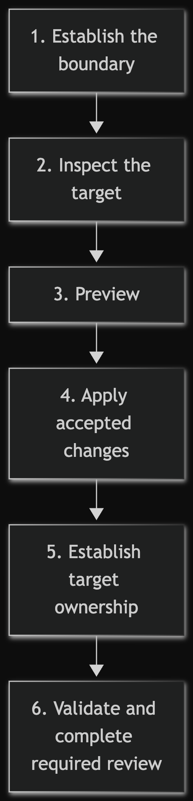
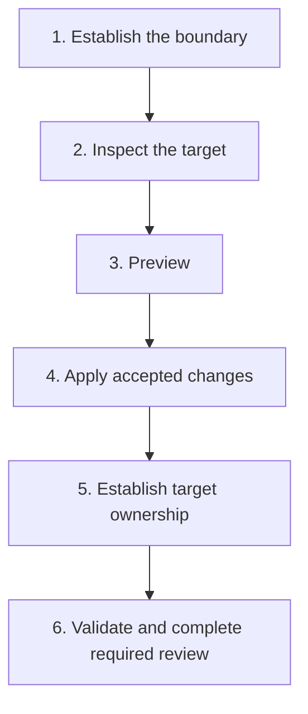
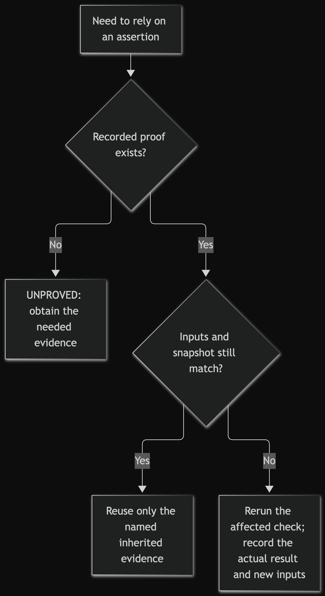
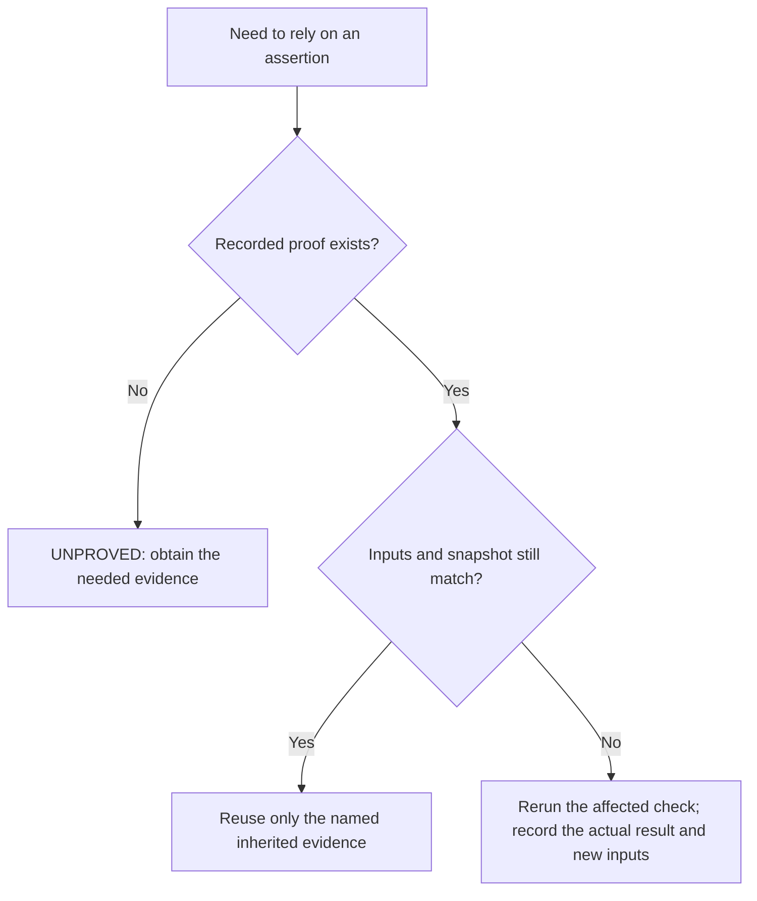

# Bootstrap Warmboot into a project

Use this walkthrough for a first integration. The goal is a small, target-owned operating contract, not a second project-management system.

## Overview

Follow six stages: establish authority and ownership, inspect the target, preview,
apply only after acceptance, make the contract target-owned, then validate and finish
any required review.

<!-- mermaid-render:begin sha256=81e7becad5c8560ec2834ef0ae35e454b4d61cd4c37408f938ddc4ae3319ca76 -->


<details><summary>Mermaid source</summary>



</details>
<!-- mermaid-render:end -->

The numbered sections are operative. The diagram grants no authority; helper success
does not complete bootstrap.

## 1. Establish the task boundary

Before running the installer, record:

- the objective and explicit non-goals;
- the target repository and current snapshot;
- the user authority currently in force;
- the coordinator, who alone holds Git (if used) and remotes;
- any other scarce-resource holders;
- hazards, acceptance conditions, and required evidence.

If ownership, authority, or the intended target is unclear, stop and resolve it before mutation.

## 2. Inspect the target

Read the target's existing instructions and their precedence, including any `AGENTS.md`,
`CLAUDE.md` or `.agent-warmboot/`, plus its active task, relevant source, tests and
configuration. Record, where present: the exact snapshot and concurrent work (Git status
and HEAD when Git is used), `BLOCKED` if it is missing or irreconcilable with the
visible target; native test, lint, build and validation commands read from current
source, never guessed from the language; root `*.code-workspace` and `.vscode/` files a
generic workspace must not erase; and secrets, personal data, privacy boundaries and
files that must not be copied, committed or sent to a provider. Preserve unrelated
changes; never absorb them into the snapshot or use them as evidence.

Then choose one integration:

- **Use the managed bundle** when the target has no conflicting files and its
  instruction precedence is understood; the preview informs the decision.
- **Reconcile manually** when useful target instructions already exist; preserve their
  semantics and stronger safety constraints (see
  [Existing agent instructions](#existing-agent-instructions)).
- **Do not integrate** when Warmboot adds no decision value, conflicts cannot be
  reconciled safely, privacy or authority is missing, or the recurring cost exceeds the
  benefit.

Inspect the target's language, framework, build manifests, native formatting, linting,
static-analysis and test facilities, and existing architecture and documentation
owners. Select only checks that address an observed boundary or risk. Do not turn a
new project into a generic tool checklist.

Research the target language and community's current source-documentation convention
from authoritative project or language guidance. Prefer that native form—such as a
module docstring, class contract or file header—over a Warmboot-specific dialect.
Record the adopted rule, owner, changed-source review evidence, and narrow exceptions.

Use one agent for a small reversible integration that changes no code. Add an independent reviewer for every code change and when the target or change carries material behavior, safety, migration, or release risk. Split parallel lanes only when their owned paths and decisions are truly independent.

### Existing agent instructions

This is the managed-bundle route. The installer refuses an existing `AGENTS.md` or
`CLAUDE.md` before writing anything. Move their project-specific content into a
target-owned file, such as `docs/agent-instructions.md`, and link it under **Governing
instructions** in the task artifact the core makes every session read (see
`templates/TASK.md`). Then remove the originals and install. The alternative is to
reconcile manually: keep the existing loaders, copy the core and routes into
`.agent-warmboot/` by hand, add one line to each loader that routes to the core, and
accept that `check` does not apply because no manifest is written.

On the small solo path that task artifact may be the README, when the README serves as
the task record.

### Small solo project

Warmboot Light is the lightweight edition of the family, and the core already allows
a small footprint:

- the task template is optional; an existing issue or plan that records the outcome
  and authority can own the work (`templates/TASK.md`);
- orientation, a system map and test commands may live in the README (stage 5 below);
- any fresh-context session that did not write the change, or a human, can be the
  independent reviewer for small changes; a substantial code package prefers a
  reviewer from another model family where one is reachable
  ([review route](routes/review.md));
- a compatible editor setup can replace the workspace seed once the user accepts it
  and the task records its path, tool, reason and command parity
  ([core](WARMBOOT.md#invariants));
- small reversible work that changes no code records `NOT REQUIRED` with a scope and
  risk reason instead of a review.

Projects that need architecture kickoff, upgrade or release tooling can use Warmboot
Full.

## 3. Preview

Run these commands from this toolkit checkout. The target must already exist and be
provided as an absolute path.

```sh
python3 bin/warmboot init /absolute/path/to/project
```

Review every proposed directory and file. The preview does not infer the target's semantics and does not prove that the contract fits the project.

## 4. Apply

After accepting the preview and target fit:

```sh
python3 bin/warmboot init /absolute/path/to/project --apply
```

Creation is non-overwriting and refuses detected replacement. It assumes no other
actor relocates opened parent directories: writes retain the opened inode, which
can move outside the target before a write. Postflight detection refuses `APPLIED`
and preserves residue; it does not provide continuous pathname containment or
rollback. Recorded residue paths may have moved. If a compatible partial install
remains after an interrupted run, inspect it and rerun. Preserve incompatible or
unexpected paths and resolve ownership rather than deleting them automatically.
Helper-created files remain `0600`, directories `0755`; the default is one OS
account, and manifest checks do not verify modes.

Do not grant package installation, remote access, publication, deployment, or credential use merely because the local contract was installed. Those effects need their own explicit authorization.

## 5. Make the target own the contract

Create or update the target's existing task artifact so it records the live objective, ownership, evidence plan, and remaining unknowns. Keep target-specific standards in target-owned sources; do not stuff the entire repository into the core.

Use existing owners first. These are destinations for decisions, not extra files to
create automatically:

| Decision | Target-owned home | What to record |
|---|---|---|
| Current work and evidence | Existing active task | Objective, holders, checks, unknowns and next action. |
| Engineering and source conventions | Existing standards or contributor guide | Native conventions, rationale, exceptions and owners. |
| Project navigation | Root README, system map and root workspace | Entry points, component ownership and usable navigation. |
| Changes and escaped defects | Existing changelog and bug-fix record | User-visible changes, defect causes and recurrence evidence. |

A tiny Python project may keep orientation, a system map and test commands in its
README, source rules in existing standards, and change, defect and task decisions in
their respective owners. Account for every required role below; do not invent defects.

### Select target-owned quality practices

Merge the following into credible existing documents, or adopt the smallest missing
owner from `templates/project-docs/`:

- target-native engineering rules and architecture boundaries;
- independently derived expectations and focused unit, table, property or metamorphic
  tests where they fit the domain;
- distinct unit, integration, end-to-end, external and human evidence tiers, with zero
  unexplained skips at final acceptance;
- formatting, linting, static or architecture checks only when their finding changes a
  decision; coverage as a way to find blind critical paths, not quotas; and mutation
  testing only where its signal justifies its recurring cost.

Consider a locally calibrated SLOC or complexity threshold as a
review/refactoring trigger when large units impair human or agent comprehension. It is
not a universal gate: record the measurement convention, evidence, exception owner and
reason. Use a small human-readable system map, Mermaid or SVG diagram only when it
makes important structure or flow materially clearer, and maintain its source beside
the relevant documentation.

The target must have one usable, target-owned root workspace. With none, adapt the seed
in `templates/project.code-workspace`; with one, merge into it in place, preserving its
name, JSONC style, unknown compatible keys and stronger target constraints; with
several, determine their purposes first, and unknown overlap is `BLOCKED`, not
permission to delete. On a same-key conflict, current target-native behavior wins; the
seed never breaks the tie. Omit the workspace only when the user explicitly accepts a
compatible human-workspace replacement and the task record documents its exact path,
tool, reason and command parity. Warmboot does not generate or validate that
workspace; editor execution not run stays `UNPROVED`.

### Adopt the coded-project floor

For a project containing human-authored code, adopt or merge these living roles; do
not silently omit one:

- a root README that states purpose and routes people into the project;
- a conventional source/test layout and a proportional ownership or system map,
  which may be one README section for a small project;
- target-native source/engineering rules and test/evidence commands;
- a changelog, an escaped-defect/bug-fix record, and one active task owner; and
- the changed-source comprehension check and independent review below.

Existing credible files may own several roles. Record the surviving path and owner so
the floor does not multiply documents. Mark a role `NOT APPLICABLE` only after inspection proves
the project has no authored code or the role genuinely cannot apply; record why and
what would reopen it.

For a materially complex or multi-component project, also adopt or merge a current
quality-control owner. Periodically assemble evidence and unknowns by applicable
component or concern—architecture and ownership, source comprehension, testing, and
security, privacy or operations when relevant—then name the next action, owner and
revisit trigger. A tiny project may keep this in its task or review. Grades, counts and
self-scores cannot close acceptance; a human or genuinely independent non-author
reviewer challenges the evidence. Automate collection and regression flags when
useful, never semantic adequacy.

### Prove changed-source comprehension

Make the target rule operational before bootstrap closes:

Where the adopted convention leaves consequential boundaries or decisions unclear,
the top-level contract names the file's role, ownership and non-ownership, operative invariants and
target-owned decision references needed to recover why they hold. Use the depth the
hazard requires. Seed a missing equivalent standard once at bootstrap, then challenge
it at existing comprehension and review gates; add no comment, documentation or
test-count quotas, prose linting or repeated text-perfection loops. Comments and API
documentation preserve why,
assumptions, invariants and usage contracts, rather than restating code.

- every human-authored code file gives immediate language-native orientation; one
  accurate sentence is sufficient for a simple file;
- consequential algorithms, constants, reconciliations and state transitions add
  adjacent explanation of why and the applicable invariants, units, precedence and
  failure, concurrency, security or resource semantics, including non-obvious
  coordinate systems, numerical limits, idempotency, retry, caching and privacy;
- an exact link to a target-owned ADR section may carry extended rationale only when
  source still states its local contract and the linked section exists;
- generated, vendored and pure re-export files use explicit, narrow exceptions rather
  than decorative prose; and existing debt is risk-inventoried and prioritized;
- the coordinator freezes and attests the candidate source set from target-native
  change/status evidence (Git when the target uses it); the writer reconciles every
  changed human-authored code file against that set before handoff;
- a fresh non-author reviewer independently repeats the reconciliation and reads
  every resulting source path. An omitted file or missing, stale or code-restating
  explanation is a release-blocking `FINDING`, even when tests pass. Stricter target
  or user review requirements still govern.

A plan promising future documentation is not evidence. Record inspected paths and the
review decision and any required verdict. Tests and ADRs supplement local
comprehension; neither substitutes for it.

### Reuse the fit loop

For another concern that can materially affect the result, use the same small loop:
research the target's authoritative community/project practice, adopt or merge the
fit rule with owner and exceptions, prove the actual changed result, then obtain the
proportionate independent challenge. Do not promote every concern into the coded-
project floor, add a tool without a named decision, or accept plan text as execution.

## 6. Validate

First verify the managed installation:

```sh
python3 bin/warmboot check /absolute/path/to/project
```

Then run the smallest target-specific checks that reach the integration hazards. `PASS`
verifies manifest-declared content and structure only. The manifest and
`SOURCE_REVISION` are self-declared: a coherent rewrite of both still passes, so
`check` proves neither authenticity nor provenance; anchor provenance to an externally
recorded commit, tag or digest. It also does not prove that the agent followed the
instructions.

Finish in the target's existing task with:

- the integration decision and exact changed paths;
- the coordinator, other resource holders, the snapshot and preserved concurrent work;
- native and helper evidence kept separate, with exact commands and results;
- the workspace path or accepted replacement, and any editor execution left `UNPROVED`;
- the review decision and verdict, `UNPROVED` or `BLOCKED` boundaries and remaining
  hazards;
- the changed-source assessment, recorded exceptions and prioritized untouched debt;
- the next authorized action.

The bootstrap is complete when the target owns the installed contract, its active task and working environment are usable, relevant hazards have proportionate evidence, and any required independent review is complete.

## Disposable install and resume example

This exercise uses the actual nine-file helper output and a tiny data-validation
receipt, not a second demo application. Commands below are instructions and expected
observations, not a recorded run. Execute from the toolkit checkout in a POSIX-like
shell with Python available. They create only a new disposable target. A real target
still needs inspection, current authority and its own quality practices above.

### Stage A: preview, install and check

```sh
export warmboot_source="$(pwd -P)"
export warmboot_demo="$(mktemp -d)"
python3 "$warmboot_source/bin/warmboot" init "$warmboot_demo"
python3 -c 'import os,pathlib; assert not list(pathlib.Path(os.environ["warmboot_demo"]).iterdir())'
python3 "$warmboot_source/bin/warmboot" init "$warmboot_demo" --apply
python3 "$warmboot_source/bin/warmboot" check "$warmboot_demo"
```

Expect a preview leaving the target empty, `APPLIED` with nine files, then `PASS`.

### Stage B: establish a target-owned receipt and workspace

The next command checks the installed paths, adapts the supplied workspace seed and
creates one filled minimal task. The target contains no authored application code;
its README records that boundary rather than pretending to satisfy a coded project's
full floor. Adding code would reopen that decision.

```sh
python3 - <<'PY'
import hashlib, json, os, pathlib, shlex
root = pathlib.Path(os.environ["warmboot_demo"])
source = pathlib.Path(os.environ["warmboot_source"])
expected = {"AGENTS.md", "CLAUDE.md", ".agent-warmboot/core.md",
            ".agent-warmboot/manifest.json"}
expected.update(f".agent-warmboot/routes/{name}.md" for name in
                ("context", "handoff", "evidence", "review", "rotation"))
assert {str(p.relative_to(root)) for p in root.rglob("*") if p.is_file()} == expected
workspace = json.loads((source / "templates/project.code-workspace").read_text())
workspace["settings"] = {"files.encoding": "utf8"}
(root / "project.code-workspace").write_text(json.dumps(workspace, indent=2) + "\n")
assert all((root / item["path"]).is_dir() for item in workspace["folders"])
(root / "README.md").write_text(
    "# Limit fixture\n\nOwner: demo coordinator. This disposable target checks "
    "limit.txt <= 20. TASK.md owns current evidence and next action.\n"
    "Open project.code-workspace in an editor supporting the VS Code workspace "
    "format; its root is this directory. Validation uses Python's integer parser "
    "and the <= 20 assertion shown in the bootstrap exercise.\n"
    "No authored application code: source/test and code-quality roles are NOT APPLICABLE; "
    "revisit before adding code. No product change or escaped defect exists.\n")
(root / "limit.txt").write_text("10\n")
assert int((root / "limit.txt").read_text()) <= 20
snapshot = hashlib.sha256((root / "limit.txt").read_bytes()).hexdigest()
(root / "TASK.md").write_text(f"""# Validate a disposable limit

- Outcome/scope: validate limit.txt <= 20; no application or external effects.
- Authority/holder: demo coordinator owns this disposable target and receipt; no Git or remote work.
- Snapshot: limit.txt sha256={snapshot}
- Hazard: reusing validation after the input changes.
- Evidence: PROVED integer value <= 20 at that digest; managed check passed before target adaptation.
- Workspace: project.code-workspace root exists; editor opening remains UNPROVED.
- Source assessment: no authored application source; workspace configuration checked for target-root navigation.
- Review: NOT REQUIRED: small reversible data-only exercise; no stricter target rule.
- Next: pause; on resume compare the input digest before relying on this result.
""")
print("Nine installed paths verified; workspace root and value checked.")
print("For a new shell, restore: export warmboot_demo=" + shlex.quote(str(root)))
PY
```

### Stage C: pause, compare inputs and rerun affected proof

Pause here. Simulate another authorized input writer changing the fixture during the
pause. In a new shell, first restore the printed `warmboot_demo` assignment; the
installed contract and live receipt carry the continuation, not the old transcript.
Opening the workspace in a compatible editor and recording that observation is still
required before claiming the human workspace usable; the JSON/root check alone does
not prove that.

```sh
printf '12\n' > "$warmboot_demo/limit.txt"
cat "$warmboot_demo/.agent-warmboot/core.md" "$warmboot_demo/TASK.md" "$warmboot_demo/.agent-warmboot/routes/handoff.md"
python3 - <<'PY'
import hashlib, os, pathlib
root = pathlib.Path(os.environ["warmboot_demo"])
task = (root / "TASK.md").read_text()
old = next(line.split("sha256=", 1)[1] for line in task.splitlines()
           if line.startswith("- Snapshot:"))
new = hashlib.sha256((root / "limit.txt").read_bytes()).hexdigest()
assert old != new
print("RERUN NOW: limit.txt moved; the old assertion is not current proof.")
assert int((root / "limit.txt").read_text()) <= 20
task = task.replace("sha256=" + old, "sha256=" + new)
task = task.replace("- Evidence: PROVED integer value <= 20 at that digest; managed check passed before target adaptation.",
                    "- Evidence: PROVED integer value <= 20 after rerun at the new digest; prior digest " + old + " is historical only.")
task = task.replace("- Next: pause; on resume compare the input digest before relying on this result.",
                    "- Next: record editor/workspace observation; bootstrap is not yet claimed complete. Managed installation evidence may be inherited only after its own inputs are checked.")
(root / "TASK.md").write_text(task)
print("Value 12 passed; only the affected validation receipt was replaced.")
PY
```

Both values satisfy the same acceptance condition, but only the rerun proves the
changed input. This exercise demonstrates receipt mechanics, not autonomous recovery
quality, human comprehension or superiority over another workflow. Retain the target
only while inspecting the example; it is not a new maintained project.

### Decide whether evidence is still current

On resume, check the inputs and snapshot for each assertion you intend to reuse.
Matching inputs allow reuse of that named evidence only; changed inputs need an
affected rerun. Missing proof remains `UNPROVED`.

<!-- mermaid-render:begin sha256=f8197d256d0854cf81324a2fa762d9921ee0317f014c6f4f26b9ee6f33a31cac -->


<details><summary>Mermaid source</summary>



</details>
<!-- mermaid-render:end -->

In plain text: a receipt records what was proved and on which inputs; it cannot make
changed or missing evidence current. A rerun may pass, fail or be unavailable; record
that result instead of assuming success. Receipts and proof labels grant no authority
and do not complete bootstrap's workspace, ownership or review requirements.
