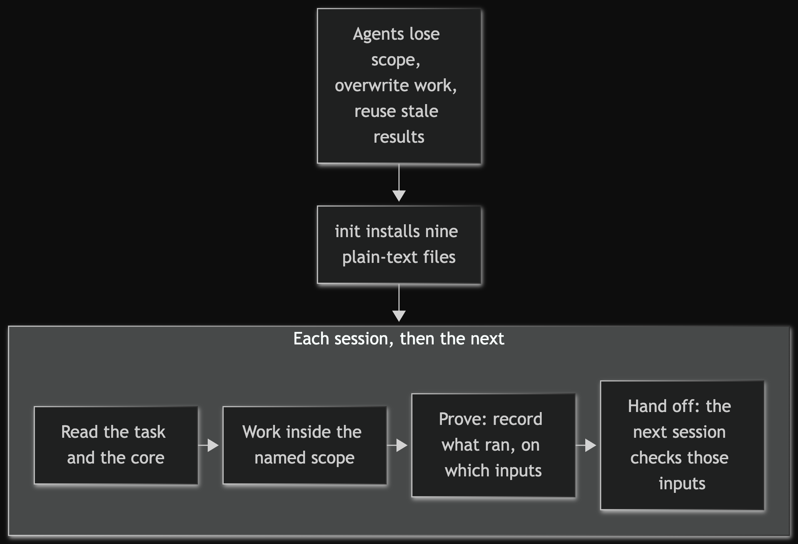
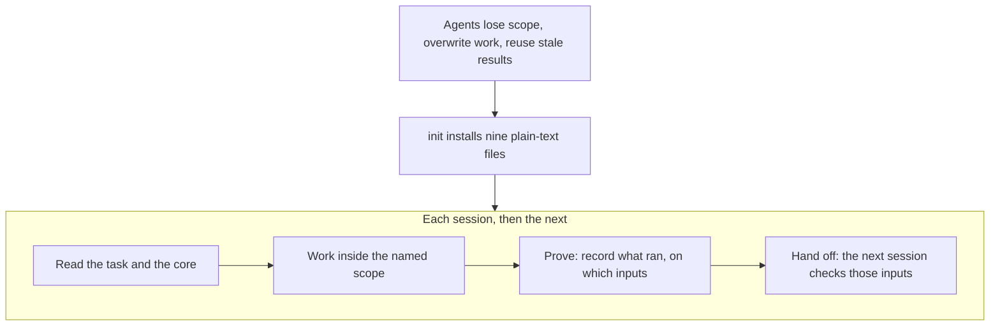
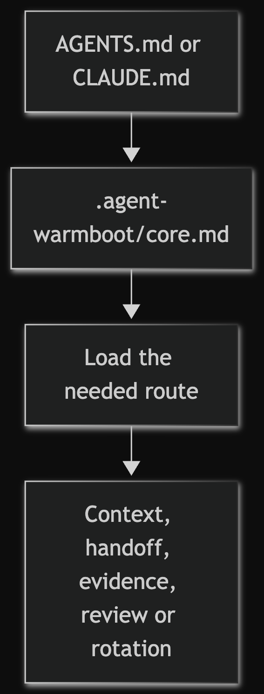
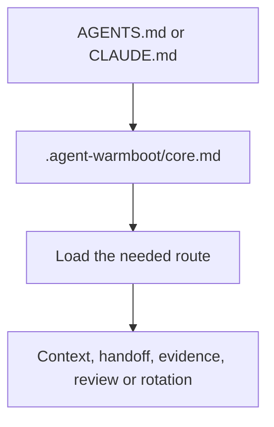
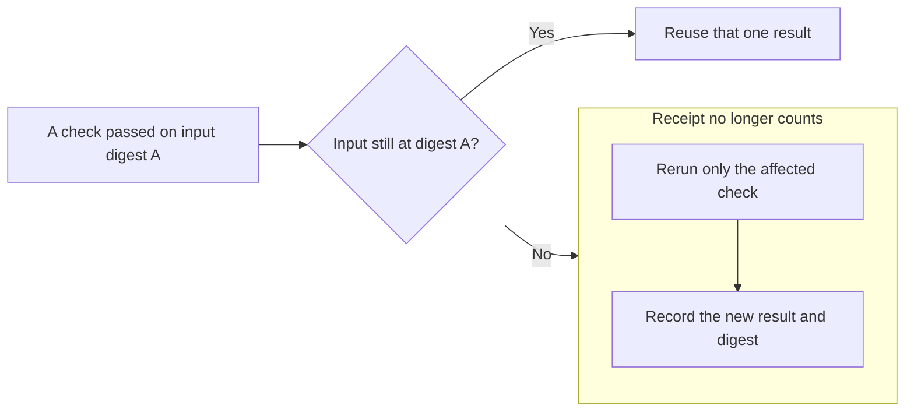
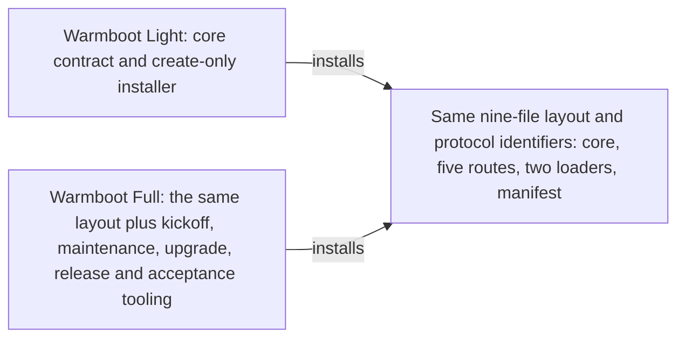

# Warmboot Light

Warmboot Light gives AI coding agents memory and rules across sessions. Without shared
state, a new session can start from zero: agents forget decisions, redo finished work,
trust test results that are no longer valid and skip review. Warmboot Light keeps a short
contract and the task's state as plain text in the repository, read through AGENTS.md or
CLAUDE.md, with no service and no dependencies to install.

Designed and directed by Tiago Fonseca; implemented and reviewed with coding agents
under this protocol. This is the compact edition of Warmboot;
[Which edition?](#which-edition) compares it with
[Warmboot Full](https://github.com/korreio/warmboot-full).

> **Status: experimental.** Warmboot is a collection of practices for running coding agents. It
> makes no promise of better results. Use it at your own risk and take what is useful.

<!-- mermaid-render:begin sha256=fdbbf7c1eddc58f24cbe778a40e194ceab7e64c7500dd6f621fae0d8d6eba70f -->


<details><summary>Mermaid source</summary>



</details>
<!-- mermaid-render:end -->

## Try it

Needs a POSIX-like platform, Python 3.11 or newer and an existing project directory
given as an absolute path. Run from this checkout: preview (writes nothing), apply, then
check:

```sh
python3 bin/warmboot init /absolute/path/to/project
python3 bin/warmboot init /absolute/path/to/project --apply
python3 bin/warmboot check /absolute/path/to/project
```

The preview of an empty project prints:

```text
PREVIEW /absolute/path/to/project (agent review required; target semantics not inferred)
CREATE-DIR .agent-warmboot
CREATE-DIR .agent-warmboot/routes
CREATE-FILE .agent-warmboot/core.md
CREATE-FILE .agent-warmboot/manifest.json
CREATE-FILE .agent-warmboot/routes/context.md
CREATE-FILE .agent-warmboot/routes/evidence.md
CREATE-FILE .agent-warmboot/routes/handoff.md
CREATE-FILE .agent-warmboot/routes/review.md
CREATE-FILE .agent-warmboot/routes/rotation.md
CREATE-FILE AGENTS.md
CREATE-FILE CLAUDE.md
NOTICE: the helper does not evaluate the required target-owned human workspace; APPLIED or PASS is not bootstrap completion
```

`APPLIED` creates the nine files; an unchanged rerun creates none. `PASS` means managed
content and structure match the manifest written at install time. Keep this checkout, or
a pinned copy, outside the target: installed files need no checkout at runtime, and
updates reconcile from a newer one. For a first integration, start the agent in this
toolkit checkout or give it this checkout's path: the installed core sends it to
`WHY.md` and `BOOTSTRAP.md` here. If the project already has `AGENTS.md` or `CLAUDE.md`,
the helper refuses; [move their rules first](BOOTSTRAP.md#existing-agent-instructions).
For a real project, follow [Bootstrap](BOOTSTRAP.md), or its [small solo
project](BOOTSTRAP.md#small-solo-project) path; its [disposable
example](BOOTSTRAP.md#disposable-install-and-resume-example) runs the whole cycle in a
throwaway directory.

## What it installs

<!-- mermaid-render:begin sha256=eacb607bcd2cd24767683a5cc47f128036b7a3811a00696bdfa10f8179b02c59 -->


<details><summary>Mermaid source</summary>



</details>
<!-- mermaid-render:end -->

The core is a copy of [WARMBOOT.md](WARMBOOT.md); `manifest.json` holds one SHA-256
digest for each of the other eight files. Templates, examples and diagrams are not
installed.

## How a session uses it

The agent opens either loader, reads the core, reuses the project's live task
(`TASK.md` or an equivalent) and names the coordinator and every other resource
holder. It loads only the route the work needs and labels each result `PROVED`,
`UNPROVED` or `BLOCKED` with the inputs it ran on. Before reusing a result, a later
session compares those inputs:

<!-- mermaid-render:begin sha256=f36013d0c1755f2e654697334a61769e141b047bc16aeb29e4e997a2eb3d517e -->


<details><summary>Mermaid source</summary>



</details>
<!-- mermaid-render:end -->

## Updating an existing installation

Rerunning `init` does not upgrade guidance whose bytes differ. Adopt later guidance
through a reviewed reconciliation in the target's existing task:

1. Record the old and proposed toolkit commits and digests, the installed manifest and
   the target snapshot with its local changes.
2. Keep a recovery copy of the managed bytes and manifest.
3. Review each applicable change against the target's own policy and record the
   decision (`ADOPT`, `MERGE INTO EXISTING`, `CITE ONLY` or `OMIT`), keeping stricter
   local rules.
4. Apply only authorized changes, then run the smallest checks that reach their
   hazards.

A manual merge makes `check` fail until a reviewed re-baseline of the exact file set and
hashes; the helper performs neither. The protocol identifiers are the managed directory
`.agent-warmboot/`, the manifest toolkit id `agent-warmboot` and manifest schema `1`;
they stay fixed for existing installations. The source revision is informational and
edition-specific (`warmboot-l0` here). Installs are interchangeable at the protocol
level: each edition's `check` passes the other's install. Moving a target to the other
edition is a reinstall of the managed set under an accepted plan, like an upgrade. There
is no release yet, and no tag, commit or hash authenticates provenance.

## What it does not do

Warmboot does not infer project semantics, judge whether the instructions are good,
replace project-specific tests, authenticate the manifest's source revision, install
dependencies, mutate Git, publish anything, or grant an agent authority.

## Design decisions

| Term | Meaning here |
|---|---|
| Coordinator | The one agent or person who holds Git and remotes for a task. |
| Holder | The single named owner of a scarce or mutable resource, such as a test runner or device. |
| Route | A focused instruction file the core loads only when the task needs it. |
| Receipt | A task or handoff record of what was proved, on which inputs and snapshot. |
| `PROVED` / `UNPROVED` / `BLOCKED` | Evidence labels: shown by a run, not shown, or missing authority or access. |
| `CLEAN` / `FINDING` / `BLOCKED` | The only terminal verdicts an independent review may return. |

| Decision | Trade-off | Where to see it |
|---|---|---|
| The installer only creates; it never overwrites, adopts or upgrades existing files. | Updates need a reviewed manual reconciliation instead of a rerun. | `bin/warmboot` (module docstring, `atomic_create`); [Updating an existing installation](#updating-an-existing-installation) |
| No rollback and no deletes: an interrupted install keeps its residue and names it. | Recovery is a human inspection, never an automatic cleanup. | `test_install_source_has_no_destructive_cleanup_path`, `test_partial_final_file_is_preserved_without_delete_and_blocks_rerun` |
| Fail closed only where it matters: the atomic no-replace rename is required; other open flags are best-effort. | Hosts without that rename cannot publish the managed directories; concurrent parent relocation is detected after the fact, not prevented. | `rename_no_replace` in `bin/warmboot`; `test_staged_directory_fails_closed_when_no_replace_is_unavailable`; [BUGFIXES.md](BUGFIXES.md) WB-004 |
| The manifest proves consistency, not authenticity: one SHA-256 per file, frozen at install, no signing. | `check` cannot tell who produced the files, and says so. | `test_check_uses_frozen_manifest_after_source_revision_changes`, `test_check_does_not_authenticate_manifest_declared_source_revision` |
| The payload stays nine files (eight self-contained Markdown files and the manifest) with no provider-specific behavior. | Templates, capability cards and examples are optional reading, never installed. | `test_installed_payload_has_exact_nine_file_allowlist`, `test_installed_sources_are_self_contained_markdown` |
| Regression pins only for reproduced defects, each with an owner, reach and deletion condition; no comment, test or coverage quotas. | Fewer permanent checks; each one must justify its upkeep. | [Regression pins](routes/evidence.md#regression-pins); WB-004 and WB-005 in [BUGFIXES.md](BUGFIXES.md); `test_quality_contract_has_no_mechanical_count_mandates` |

### Guided tour

1. [WARMBOOT.md](WARMBOOT.md): the installed core, short enough to read in full.
2. [routes/evidence.md](routes/evidence.md): how a result stays tied to
   its inputs, and when a regression pin is allowed.
3. [bin/warmboot](bin/warmboot): read the module docstring, then `atomic_create` and
   `check_command`.
4. [tests/test_warmboot.py](tests/test_warmboot.py): start at
   `test_late_parent_rename_preserves_inode_and_warns_paths_may_have_moved`, a
   deterministically injected late parent rename on the real filesystem, and the limit
   it pins.
5. [BUGFIXES.md](BUGFIXES.md): the observed defects, how each was reproduced and when its
   check may be deleted.

## Evaluate the claims

Run every command from the repository root with `PYTHONDONTWRITEBYTECODE=1` set.

| Claim | Files | Command that checks it |
|---|---|---|
| A preview writes nothing; apply installs exactly nine files. | `bin/warmboot`, `tests/test_warmboot.py` | `python3 -m unittest discover -s tests -k nine_file -k without_mutation -k apply_installs` |
| Existing files are never overwritten or deleted. | `bin/warmboot`, `tests/test_warmboot.py` | `python3 -m unittest discover -s tests -k conflict -k never_overwrites -k no_destructive` |
| The installed core and routes are byte-identical to this checkout's and self-contained. | `WARMBOOT.md`, `routes/`, `tests/test_warmboot.py` | `python3 -m unittest discover -s tests -k installed_projection -k self_contained` |
| `check` uses the frozen manifest and does not authenticate provenance. | `bin/warmboot`, `tests/test_warmboot.py` | `python3 -m unittest discover -s tests -k frozen_manifest -k does_not_authenticate` |
| Installation fails closed without an atomic no-replace rename and reports a late parent rename. | `bin/warmboot`, `tests/test_warmboot.py` | `python3 -m unittest discover -s tests -k fails_closed -k late_parent` |
| A test-local judge encodes the source-review rule on synthetic Java cases (it does not test a reviewer). | `routes/review.md`, `tests/test_warmboot.py` | `python3 -m unittest discover -s tests -k source_review` |
| The protocol requires an affected rerun when inputs change; the disposable example demonstrates it. | `routes/evidence.md`, `BOOTSTRAP.md` | The three `sh` blocks in the [disposable example](BOOTSTRAP.md#disposable-install-and-resume-example) |
| Each diagram wrapper matches its Mermaid source digest and its image exists. | `tools/render_mermaid_docs.py`, Markdown files | `python3 -B tools/render_mermaid_docs.py --root . --check` |
| The suites run on Linux and macOS. | `.github/workflows/tests.yml` | The workflow's run records |

## Evidence and limits

The native suite exercises preview, apply and check, refusals and managed file state;
the disposable install and resume example runs separately. CI runs both on Ubuntu and
macOS; [TASK.md](TASK.md) records the runs. Synthetic cases check bounded source-review
decisions.

The instructions need cooperating agents; host permissions or isolation enforce access.
A manifest match shows content consistency, not source authenticity, engineering quality
or agent quality. Provider-neutral design does not prove equal behavior across
providers. Helper-created files are `0600` and directories `0755` for one OS account;
`check` ignores modes. Installation assumes no other actor relocates an opened parent
directory: a concurrent rename is detected and refused afterwards, not prevented, and
the helper never rolls back.

No conclusive data on its benefit is available yet. Feedback and reports from use are
welcome. The [comparison protocol](examples/comparison/README.md) describes how such a
comparison could be run; workspace usability and agent adherence remain unproved.

## Repository map

| Path | Purpose | Entry point |
|---|---|---|
| `WARMBOOT.md`, `routes/` | The installed core and its five routes. | [`WARMBOOT.md`](WARMBOOT.md) |
| `AGENTS.md`, `CLAUDE.md` | Loaders for agents working on this checkout. | [`AGENTS.md`](AGENTS.md) |
| `bin/` | The create-only installer and checker. | [`bin/warmboot`](bin/warmboot) |
| `tests/` | Installer, document-contract and diagram-helper tests. | [`tests/test_warmboot.py`](tests/test_warmboot.py) |
| `tools/` | Mermaid diagram renderer and wrapper check. | [`tools/render_mermaid_docs.py`](tools/render_mermaid_docs.py) |
| `templates/` | Optional seeds for a target's documents and workspace. | [`templates/capabilities/README.md`](templates/capabilities/README.md) |
| `examples/` | Synthetic cold and guided projects and a comparison protocol. | [`examples/python-guided/README.md`](examples/python-guided/README.md) |
| `docs/` | Documentation architecture, release guide and maintainer guide. | [`docs/documentation-architecture.md`](docs/documentation-architecture.md) |
| `mermaid/`, `docs/**/mermaid/` | Rendered diagram images owned by the renderer. | [`tools/render_mermaid_docs.py`](tools/render_mermaid_docs.py) |
| `.github/` | CI for Ubuntu and macOS, security policy, contribution guide and issue forms. | [`.github/workflows/tests.yml`](.github/workflows/tests.yml) |
| `WHY.md`, `BOOTSTRAP.md` | Design intent and the first-integration walkthrough. | [`BOOTSTRAP.md`](BOOTSTRAP.md) |
| `TASK.md`, `CHANGELOG.md`, `BUGFIXES.md` | Validation record, dated changes and observed defects. | [`TASK.md`](TASK.md) |
| `SOURCE_REVISION`, `*.code-workspace` | Self-declared revision label and editor workspace. | [`warmboot.code-workspace`](warmboot.code-workspace) |

## Which edition?

<!-- mermaid-render:begin sha256=41484d114c18c984bde72f4879338060f5f97bb8cee8a99a9e4010131af6dbbc -->


<details><summary>Mermaid source</summary>



</details>
<!-- mermaid-render:end -->

[Warmboot Full](https://github.com/korreio/warmboot-full) has its own repository;
each repository owns its own evidence.

## Validate this checkout

```sh
PYTHONDONTWRITEBYTECODE=1 python3 -m unittest discover -s tests -v
python3 -B tools/render_mermaid_docs.py --root . --check
```

The second command checks diagram wrappers, digests and images without rendering. After
editing a Mermaid fence, regenerate with `python3 -B tools/render_mermaid_docs.py --root
.`; this needs an installed `mmdc` (Mermaid CLI) and accepts `--puppeteer-config` for a
local browser. Maintainer duties are in [docs/maintaining.md](docs/maintaining.md).

## License

MIT, copyright 2026 Tiago Fonseca; see [LICENSE](LICENSE). The installed core carries
the full notice, so the nine-file payload includes it. Keep the notice when copying
substantial portions.
