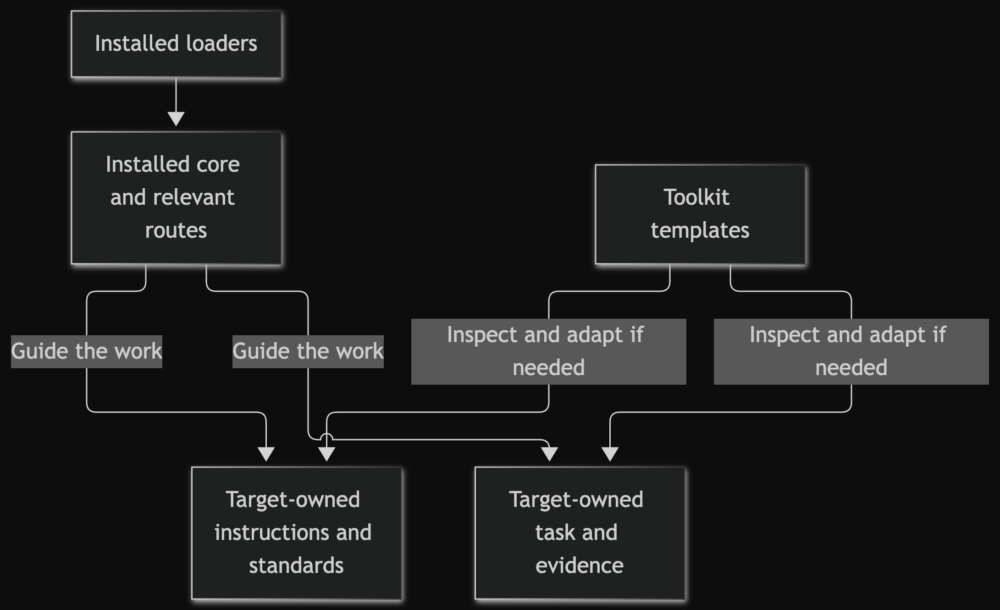
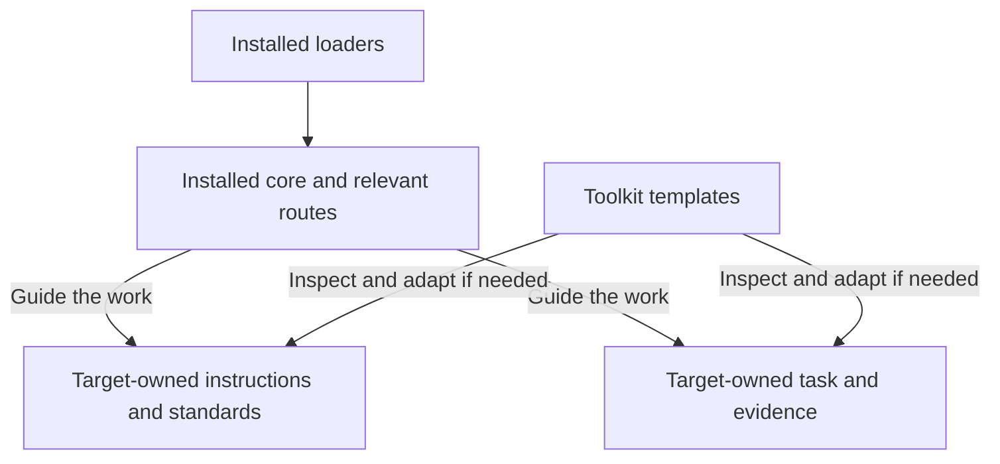

# Warmboot documentation architecture

Warmboot treats documentation as a small set of owned engineering roles. A file
belongs only when it helps a person or agent make a current decision. Templates are
seeds: inspect the target first, adapt only what it needs, and remove the seed notes.

## Ownership map

Installed guidance supplies the common operating contract. The target keeps its own
policy, current task and evidence; templates are optional seeds for missing owners.

<!-- mermaid-render:begin sha256=faeb293b0ca62ba8fe216a9e9efdedf17320ee46fe5d16cd95b44a730114602c -->

Mermaid source

<!-- mermaid-render:end -->

In plain text: follow the common contract alongside the target's own rules; keep live
decisions and evidence with their target owners. A template is not an authority or a
second maintained truth. The precedence rules below resolve which source to consult.

## The four dispositions

Use one disposition whenever you consider a seed or an optional practice:

| Disposition | Use when | Concrete example |
|---|---|---|
| `ADOPT` | The role is missing, useful now, and has an owner. | Seed a missing test guide with the actual command and evidence limits. |
| `MERGE INTO EXISTING` | An existing file owns the role; add only missing facts there. | Add test commands to the existing root README instead of creating a second guide. |
| `CITE ONLY` | The idea is useful background, but maintaining a copy duplicates truth. | Link to a dated design rationale while keeping current decisions in the target. |
| `OMIT` | The role is irrelevant, speculative, unowned, or costs more than it helps. | Omit a separate release guide while there is no deliverable or publication workflow; revisit if one is adopted. |

Record the choice in the current task. For `MERGE INTO EXISTING`, name the surviving
file. For `OMIT`, name the condition that would make the role worth reconsidering.

## Coded-project floor

Disposition does not make basic human operability optional. A project with authored
code must have living owners for: root orientation, conventional source/test structure
and a proportional system map, target-native source/engineering rules, test/evidence
commands, changelog, escaped-defect record, active task, and the changed-source
comprehension check with independent review. A small reversible task that changes no
code records `NOT REQUIRED` and its scope/risk reason, subject to stricter
target/user rules; the writer still assesses every changed source path. One credible
file may own several roles; merge instead of creating ceremony. A no-code project may
record `NOT APPLICABLE` with evidence and a reopen condition.

For a materially complex or multi-component project, merge a current quality-control
loop into the plan, system map or one owned assessment. It gathers evidence and
unknowns by applicable component/concern, assigns the next improvement and revisit
trigger, and receives human or independent non-author challenge. Scores and automated
collection may inform it; neither can judge semantic adequacy or self-close acceptance.

## What every adopted document needs

An adopted document states:

- its owner and the decisions it is authoritative for;
- the evidence a reader should check before relying on it;
- the change that requires maintenance; and
- the condition for merging, retiring, or revisiting it.

No document grants Git, package, network, credential, deployment, release, or
publication authority. Those permissions come only from the user or the target's
current authority surface. Missing required permission is `BLOCKED`; missing proof is
`UNPROVED`.

## Small default set

Start with existing project documentation. Open a seed only when its role is missing.

| Need | Seed | Merge or omit rule |
|---|---|---|
| Current outcome, scope, owners, and evidence | [`TASK.md`](../templates/TASK.md) | Merge into an issue or plan that already carries these facts; omit only when another live artifact is unambiguous. |
| A short, freshness-aware transfer | [`HANDOFF.md`](../templates/HANDOFF.md) | Merge into the live task when practical; omit when no state is changing hands. |
| Human project entry point | [`project-docs/README.md`](../templates/project-docs/README.md) | Merge into the root README; omit a second entry point. |
| Durable implementation rules | [`project-docs/engineering-standards.md`](../templates/project-docs/engineering-standards.md) | Merge into an existing contributor guide; omit rules already enforced and obvious from tooling. |
| Test commands and evidence limits | [`project-docs/testing.md`](../templates/project-docs/testing.md) | Merge into existing test docs or standards; omit a separate guide when those routes are already clear. |
| Stable boundaries and ownership | [`project-docs/system-map.md`](../templates/project-docs/system-map.md) | Merge into existing architecture docs or one README section for a small project. |
| User-visible change history | [`project-docs/CHANGELOG.md`](../templates/project-docs/CHANGELOG.md) | Merge into an existing changelog; no second ledger. |
| Escaped-defect learning | [`project-docs/BUGFIXES.md`](../templates/project-docs/BUGFIXES.md) | Merge into an existing issue/defect ledger only when it retains reproduction and evidence. |

The root [`project.code-workspace`](../templates/project.code-workspace) is a minimal
technical seed. Every adopted target needs one usable, target-owned root workspace:
adapt this seed or merge its useful surface into the target's existing root workspace.
`OMIT` is valid only when the user explicitly accepts a compatible human-workspace
replacement documented with its path, tool, reason, and command parity. The target's
workspace owner maintains roots and shared settings; opening it proves only local
navigation. Revisit it when those surfaces change. It grants no command or
external-effect authority.

Optional capability cards are indexed in
[`templates/capabilities/README.md`](../templates/capabilities/README.md). They are
decision prompts, not an installation checklist.

## Precedence and freshness

Use the smallest source that can answer the question:

1. explicit user direction and current project authority;
2. current source, configuration, tests, and observed behavior;
3. project instructions and named living documentation owners;
4. the active task and accepted decisions;
5. dated evidence and superseded material.

When prose conflicts with executable reality, verify the behavior and correct the
living owner in the same change. A handoff points to authorities; it does not replace
them.

## Lifecycle

- Update a living document in place; do not create `final-v2` copies.
- Date evidence that should remain frozen.
- Keep temporary artifacts only while their named decision is open.
- Remove an adopted seed when its role moves elsewhere or stops changing decisions.
- Review this architecture when role selection, precedence, or authority boundaries
  change; its maintainer owns that review and link check.
