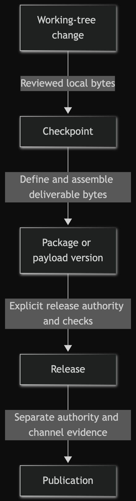
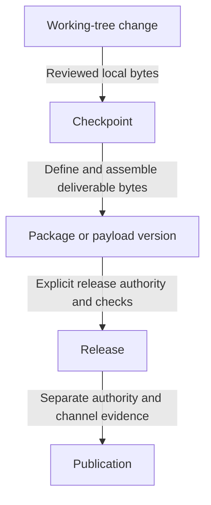

# Versioning, packaging, release, and publication

This guide exists to prevent one completed step from being mistaken for another. Merge
it into an existing release guide when that guide already separates these boundaries.
Omit it when the project has no package, payload, release, or publication workflow.

- Owner: the target's named release-process owner.
- Authority: descriptive only; this guide grants no Git, package, credential, network,
  release, or publication permission.
- Evidence: record exact inputs, outputs, commands, and results for the boundary being
  claimed.
- Maintenance: update when version ownership, payload contents, release checks, or
  publication channels change.
- Revisit or retire: merge or remove when a native guide owns the same decisions.

## Five different states

Working changes, checkpoints, versioned payloads, releases and publication are
distinct claims, not a required fixed pipeline. A project need not use every state
or follow this ordering. Each used boundary needs its own owner, authority and
evidence; the table defines the precise meaning and minimum sufficient proof.

<!-- mermaid-render:begin sha256=3a8a429d31f97cba2f86e6302d861baa4165902261b357ceea4aead7645450d5 -->

Mermaid source

<!-- mermaid-render:end -->

| State | What it means | Minimum sufficient evidence | What it does not mean |
|---|---|---|---|
| Working-tree change | Files differ from the current local baseline. | Named changed paths and relevant local checks. | Checkpointed, packaged, released, or published. |
| Checkpoint | A named local repository state records reviewed bytes. | Exact local identity plus a clean or explicitly described state. | Approved for a remote, a release, or distribution. |
| Package or payload version | A version label describes a defined set of deliverable bytes. | Payload inventory, version source, and reproducible local build or assembly evidence. | Released, available, or authentic. |
| Release | An authorized owner designates an exact checkpoint and payload as a release. | Target-native release checks and an immutable identity chosen under explicit authority. | Published to anyone or any service. |
| Publication | An authorized operator makes the exact approved release available through a named channel. | Channel result observed against the approved identity. | That every recipient trusts, installed, or successfully used it. |

Do not collapse these states into a single `version` field. A package version can exist
without a release; a release can exist without publication; local completion authorizes
neither.

## Minimal record

For any boundary that is actually used, record:

- decision owner and separately authorized operator;
- source checkpoint and payload inventory;
- version source and compatibility meaning;
- checks run, inputs, results, and unavailable proof;
- destination channel, only when publication is explicitly authorized; and
- recovery or withdrawal owner, without assuming permission to act.

No hash, manifest, tag, signature-shaped field, or successful check authenticates an
artifact by itself. State only the integrity or reproducibility property actually
proved. Credentialed signing, remote verification, release creation, and publication
remain separate authorized actions.

## Change and review rule

Keep working changes reversible until reviewed. Recheck the exact candidate after any
changed byte. Stop when an intended boundary lacks an owner, permission, or required
evidence. Update this guide when the distinction among checkpoint, payload, release, or
publication changes; otherwise prefer the project's native process and retire this
copy.
